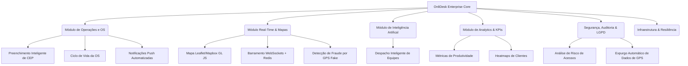

# 🎯 OnliDesk App — Guia de Funcionalidades e Manual Operacional
## Gestão Corporativa de Equipes de Campo e Geomonitoramento em Tempo Real

---

> [!NOTE]
> Este documento consolida de forma analítica a totalidade dos recursos, módulos e propósitos da plataforma **OnliDesk App**. Ele serve tanto para onboarding de usuários corporativos de alto nível quanto para documentação técnica de referência de produto.

---

## 1. Visão Geral da Plataforma

O **OnliDesk App** é uma solução de nível empresarial (*Enterprise*) projetada para centralizar, monitorar, gerenciar e otimizar equipes de campo e operações de suporte técnico. A plataforma destaca-se por sua **experiência visual premium baseada em Glassmorphism**, seu suporte nativo ao **tempo real** via barramento de eventos (Redis e WebSockets) e a inteligência de alocação de serviços em campo.

### 💡 Proposta de Valor
Empresas que dependem de equipes externas de instalação, manutenção ou auditoria enfrentam três desafios clássicos: **lentidão no despacho**, **falta de visibilidade em tempo real** e **drenagem de bateria nos dispositivos móveis**. O OnliDesk resolve estas dores unificando:
1. **Inteligência de Alocação (IA):** Encontra o melhor técnico considerando tráfego, localização e carga de trabalho.
2. **Controle de SLA Fino:** Avisa gerentes e técnicos antes do vencimento do prazo.
3. **Resiliência Mobile:** Coleta de dados geográficos no aplicativo Android com cache offline inteligente que não esgota a bateria do trabalhador.
4. **Infraestrutura SaaS Sustentável:** Utilização de tecnologias Open-Source (Leaflet, PostgreSQL com partições, Redis) que reduzem o custo de infraestrutura em até 90% em comparação com outras soluções do mercado.

---

## 2. Estrutura de Módulos e Funcionalidades Detalhadas

---

### MÓDULO A: Gestão de Ordens de Serviço (OS)

Este é o núcleo operacional da plataforma. Ele permite criar, rastrear, editar e finalizar tarefas enviadas para as equipes em campo.

*   **Preenchimento Inteligente de CEP (ViaCEP API):**
    *   *Como Funciona:* Ao cadastrar ou editar uma OS, o operador insere apenas o número do CEP. O sistema faz uma chamada automática à API de consulta postal ViaCEP e preenche instantaneamente os campos: **Logradouro (Rua)**, **Bairro**, **Cidade** e **Estado**.
    *   *Propósito de Uso:* Acelerar o tempo de digitação do operador e, crucialmente, garantir que o endereço esteja 100% correto e formatado para o correto traçado de rota no GPS do técnico. O operador só precisa preencher o número físico do local.
    *   *Preview de Endereço Consolidado:* O formulário renderiza uma prévia em tempo real de como o endereço será consolidado no banco de dados na estrutura padrão: `"${rua}, ${numero} - ${bairro}, ${cidade} - ${estado}"`.
*   **Edição Avançada e Interativa de OS:**
    *   *Como Funciona:* O usuário pode abrir o painel de edição de uma OS de duas formas: clicando diretamente sobre o número da OS na lista principal ou utilizando o botão de ações rápidas "Editar".
    *   *Propósito de Uso:* Facilidade e agilidade de uso por parte do despachante, permitindo correções de dados, reatribuição de técnicos ou alteração de prioridades sem sair do foco visual.
*   **Ciclo de Vida e Fluxo de Estados da OS:**
    *   *Como Funciona:* Cada OS transiciona organicamente entre os estados: `Pendente` ➔ `Atribuída` ➔ `Em Trânsito` ➔ `Em Andamento` ➔ `Concluída` ou `Cancelada`.
    *   *Propósito de Uso:* Monitoramento preciso de funil operacional. Permite saber exatamente quanto tempo cada profissional gasta se deslocando versus executando o trabalho na ponta.

---

### MÓDULO B: Telemetria e Monitoramento em Tempo Real

Responsável pela visibilidade espacial e geográfica das equipes no mapa interativo.

*   **Arquitetura Híbrida de Mapas (Leaflet + Mapbox GL JS):**
    *   *Como Funciona:* Combina o **Leaflet (L1)** (utilizando OpenStreetMap gratuito e servidor de rotas auto-hospedado OSRM) com a renderização dinâmica em **Mapbox GL JS (L2)** para frotas de grande porte que precisam de telemetria de trânsito em tempo real.
    *   *Propósito de Uso:* Proporcionar economia drástica de custos em projetos menores enquanto mantém capacidade corporativa de monitorar centenas de veículos no mesmo mapa com agrupamento rápido de chamados (*Marker Cluster*).
*   **Detecção de Fraude por Spoofing de GPS:**
    *   *Como Funciona:* O backend analisa as coordenadas de telemetria enviadas pelo aparelho móvel em dois níveis:
        1.  Verifica se a flag `isFromMockProvider()` nativa do Android está ativa.
        2.  Calcula a velocidade vetorial em relação à coordenada anterior. Se a velocidade calculada for inconsistente (ex: superior a 160 km/h em perímetro urbano), o sistema gera um alerta.
    *   *Propósito de Uso:* Garantir a conformidade operacional, evitando que técnicos burlem o sistema simulando trajetos falsos usando aplicativos de simulação geográfica.
*   **Controle de Nível de Bateria e Status de Dispositivo:**
    *   *Como Funciona:* A cada sinal de localização enviado (WebSocket/HTTP), o app envia o nível de bateria atual do smartphone e sua temperatura.
    *   *Propósito de Uso:* Alertar o gerente de despachos se o técnico está com pouca carga no aparelho antes de atribuir uma OS distante, mitigando o risco de o profissional ficar incomunicável durante o atendimento.

---

### MÓDULO C: Despacho Inteligente Assistido por IA (AI Dispatch)

Substitui a decisão puramente manual de distribuição de tarefas por recomendações heurísticas avançadas.

*   **Motor de Alocação Dinâmica:**
    *   *Como Funciona:* Processa dados operacionais brutos via Inteligência Artificial (Google Gemini API integrada) para correlacionar:
        1.  Posição geográfica atualizada do técnico.
        2.  Carga de trabalho restante dele no dia (quantas OS estão em sua fila).
        3.  Nível de urgência da nova OS e seu prazo de SLA.
        4.  Perfil técnico / Habilidades necessárias para realizar aquela OS específica.
    *   *Propósito de Uso:* Otimizar custos operacionais de deslocamento e garantir que o técnico mais qualificado e geograficamente próximo receba o chamado, reduzindo drasticamente o tempo médio de resposta ao cliente final.

---

### MÓDULO D: Estatísticas Avançadas e Analytics Executivo

Transforma dados operacionais frios em painéis gerenciais e inteligência competitiva.

*   **Painel Executivo e KPIs de Performance:**
    *   *Como Funciona:* Consolida informações de todas as OS gerando indicadores de:
        *   *SLA Compliance:* Percentual de chamados atendidos dentro do limite contratual de tempo.
        *   *Tempo Médio de Conclusão (MTTR):* Eficiência média de atendimento das equipes.
        *   *Taxa de Produtividade Individual:* Número de OS finalizadas por técnico por dia de trabalho.
        *   *Volumetria por Status:* Visão macro do estoque de chamados.
    *   *Propósito de Uso:* Permitir que diretores e gerentes tomem decisões estratégicas (ex: contratação de mais técnicos, redimensionamento de regiões de atendimento ou redesenho de rotas recorrentes).
*   **Cache Redis de Alta Performance:**
    *   *Como Funciona:* Os dados agregados de estatísticas não são calculados do banco a cada requisição. O sistema utiliza um banco em memória **Redis** como camada de cache dinâmico com TTL (tempo de vida) de 5 minutos, que é invalidado inteligentemente apenas quando novas OS sofrem mutação.
    *   *Propósito de Uso:* Evitar sobrecarga de leitura no PostgreSQL de produção em períodos de pico de uso da plataforma.
*   **Exportação Analítica em CSV:**
    *   *Como Funciona:* Permite baixar as tabelas de produtividade de técnicos agregadas.
    *   *Propósito de Uso:* Facilitar integrações corporativas com Excel, PowerBI ou sistemas de cálculo de folha de pagamento baseada em produtividade.

---

### MÓDULO E: Segurança da Informação, Auditoria e LGPD

Conformidade e controle rígido sobre os dados de operações e acesso.

*   **IP Geolocation & Análise de Risco de Sessão:**
    *   *Como Funciona:* No login de cada operador, o sistema analisa o IP e realiza a geolocalização do acesso (País, Cidade, Provedor de Internet). Ele busca por assinaturas conhecidas de **VPN, Proxies ou redes de anonimização TOR**, gerando um Score de Risco de 0 a 100.
    *   *Propósito de Uso:* Identificar conexões suspeitas e mitigar ataques do tipo brute-force ou sequestro de contas, alertando os administradores em tempo real no painel de **Alertas de Segurança**.
*   **Centro de Auditoria Administrativa (Logs de Auditoria):**
    *   *Como Funciona:* Registra de forma imutável no banco de dados qualquer ação de modificação relevante no sistema: reset de senhas, alteração de permissões, deleção de ordens ou mudanças em configurações de SMTP/WhatsApp.
    *   *Propósito de Uso:* Atender requisitos clássicos de governança interna e conformidade regulatória.
*   **Expurgo e Anonimização de Dados de GPS (LGPD):**
    *   *Como Funciona:* As localizações históricas salvas na tabela `gps_history` são limpas ou anonimizadas após um ciclo configurável de 30 dias.
    *   *Propósito de Uso:* Estar em total conformidade com a Lei Geral de Proteção de Dados (LGPD), garantindo que dados de geolocalização sensível dos funcionários não permaneçam nos servidores perpetuamente sem justificativa legal de negócios.

---

### MÓDULO F: Notificações Integradas (Omnichannel)

Garante que as informações sobre as OS circulem em tempo recorde para todos os envolvidos.

*   **Push Notifications (Firebase Cloud Messaging - FCM):**
    *   *Como Funciona:* Envia mensagens push diretamente para o celular Android do técnico quando ele é atribuído a uma nova OS, se houve alteração na prioridade, ou quando a OS está próxima de expirar o SLA.
    *   *Propósito de Uso:* Rápida resposta operacional do técnico em campo, que recebe o aviso de nova tarefa mesmo com o aplicativo fechado ou com a tela desligada.
*   **Central de Preferências e Quiet Hours (Não Perturbe):**
    *   *Como Funciona:* Cada técnico pode configurar no sistema se deseja ou não receber determinados tipos de alertas e definir suas "Quiet Hours" (Horários de Silêncio), período no qual apenas notificações críticas furam o bloqueio.
    *   *Propósito de Uso:* Respeitar o período de descanso e direitos trabalhistas das equipes em períodos em que não estão em plantão ativo.
*   **Disparador e Notificador via WhatsApp Business API:**
    *   *Como Funciona:* Integração com gateways de WhatsApp para enviar atualizações de status de OS para o cliente final.
    *   *Propósito de Uso:* Manter o cliente informado sobre o deslocamento do técnico ("*O técnico João está a caminho do seu endereço...*"), reduzindo a ansiedade do cliente e aumentando os índices de satisfação com o serviço.

---

### MÓDULO G: Infraestrutura, Resiliência e DevOps

Garante que a plataforma permaneça online, rápida e segura.

*   **Sistema de Backups Automatizado e Encriptado:**
    *   *Como Funciona:* Executa diariamente às 00:00 um dump físico do PostgreSQL. O arquivo gerado é comprimido com gzip, encriptado em nível de arquivo com algoritmo militar **AES-256-GCM** e enviado progressivamente para nuvem privada S3 (MinIO ou AWS S3).
    *   *Propósito de Uso:* Garantia de desastre-recovery de altíssimo nível. Possui recurso integrado de **Restore Dry-run** que valida a integridade do arquivo antes de executar a restauração de fato.
*   **Gerenciador de Filas de Mensagens e background jobs:**
    *   *Como Funciona:* Processamentos pesados (envio de e-mails via SMTP corporativo, processamentos de lotes de relatórios, disparos em lote) são colocados em filas de processamento assíncrono.
    *   *Propósito de Uso:* Garantir que a requisição do usuário web termine em milissegundos, delegando tarefas pesadas de rede para o processamento de segundo plano (*background worker*).

---

## 3. Resumo de Endpoints Críticos (Tabela de Referência da API)

Para desenvolvedores e integradores do OnliDesk, a API expõe os seguintes barramentos funcionais de destaque:

| Rota HTTP | Método | Função Operacional | Propósito |
| :--- | :--- | :--- | :--- |
| `/api/ordens` | `POST` | Criação de Ordem de Serviço | Registrar um novo chamado operacional |
| `/api/ordens/:id` | `PUT` | Edição Completa da OS | Atualizar endereço, CEP, detalhes ou prioridade |
| `/api/ordens/:id/assign` | `PUT` | Atribuição de Técnico | Associar um técnico responsável por executar a OS |
| `/api/ordens/:id/status` | `PUT` | Atualização de Status da OS | Alterar para Em Andamento, Concluída ou Cancelada |
| `/api/stats/dashboard` | `GET` | KPIs Executivos do Sistema | Alimentar os gráficos gerenciais de produtividade e SLA |
| `/api/push/device-tokens`| `POST`| Registro de Token FCM | Vincular o aparelho Android do técnico às notificações |
| `/api/backups` | `POST` | Disparo Manual de Backup | Salvar cópia fria e criptografada dos dados operacionais |
| `/api/security/alerts` | `GET` | Listar Alertas de Segurança | Dashboard de detecção de invasões e acessos via VPN |
| `/api/ai/dispatch` | `POST` | Executar Despachante IA | Acionar o recomendador inteligente Gemini para novos chamados |

---

> [!TIP]
> **OnliDesk App** é uma plataforma que se adapta à maturidade de cada empresa. É possível iniciar com controle puramente manual de OS utilizando mapas open-source gratuitos (Leaflet + OpenStreetMap) e, à medida que a operação escala para centenas de colaboradores, habilitar o despacho via IA, geomonitoramento de alta fidelidade e controle dinâmico de tráfego.

---
*Este guia foi gerado para documentar os aspectos operacionais do sistema OnliDesk App. Versão do produto: Enterprise v1.0.0.*
